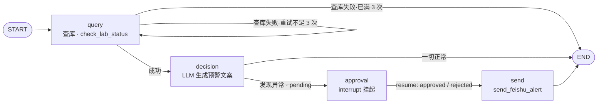
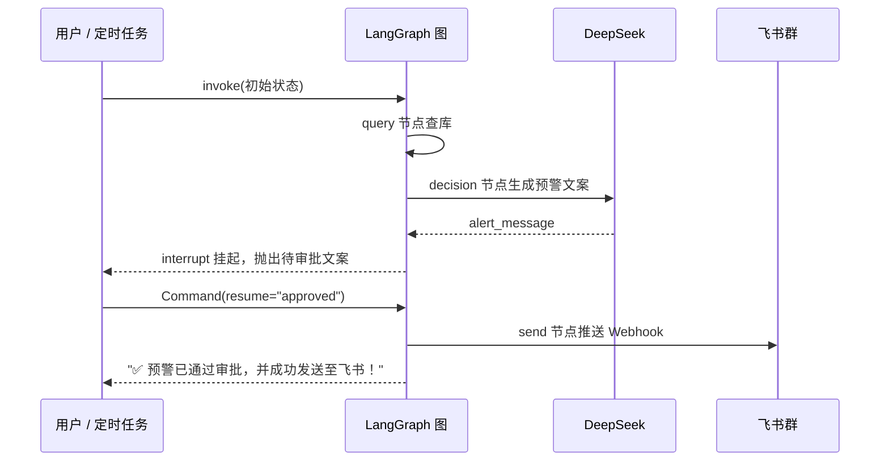

# 🤖 AutoMaint-Agent · 实验室设备智能预警管家

> 一个会自己查库、自己写预警、还会先问你一句“发不发”的实验室设备维保 Agent。

<p>
  
  
  
  
  
  
</p>

---

## 📖 项目简介

**AutoMaint-Agent** 是一个面向实验室设备维保场景的智能巡检系统。它把“人盯表格”变成“数据找人”：

每天定时唤醒 → 连接 MySQL 扫描全量设备 → 识别**维护超期**与**耗材告急**两类风险 → 由大模型把冷冰冰的查询结果写成一段可直接发群里的中文预警 → **等你点“同意”** → 推送到飞书群。

系统提供**两条独立链路**，共用同一套工具层：

| 链路 | 入口 | 编排方式 | 是否人工审批 | 适用场景 |
| :--- | :--- | :--- | :---: | :--- |
| **无人值守巡检** | `agent_core.py` / `run_agent.bat` | LangGraph 状态机 | 终端交互式（y/n） | Windows 任务计划程序、服务器 Cron |
| **Web 交互看板** | `graph-app.py`（推荐） | LangGraph 状态机 | 页面按钮审批 | 演示、值班人员按需触发 |
| **Web 交互看板（旧版）** | `app.py` / `stratapp.bat` | LangChain `create_agent` ReAct 循环 | 无（模型自主发送） | 快速对话式查询 |

> 核心设计取舍：**预警是要发到真人工作群里的**。所以生产链路没有把决定权交给模型“直接发”——LangGraph 在 `send` 节点前插了一个 `interrupt()`，把大模型写的文案挂起，等人确认。

---

## ✨ 核心特性

- **🧠 用状态机而不是“许愿式提示词”**：`StateGraph` 显式定义 `query → decision → approval → send` 四个节点，路由条件可读、可测、可回放，而不是靠一句“请务必调用发送工具”去赌模型听话。
- **🛑 Human-in-the-loop（人在环上）**：基于 LangGraph 的 `interrupt()` + `Command(resume=...)` 实现真正的流程挂起/恢复，`MemorySaver` 让挂起状态跨 HTTP 请求存活。驳回即终止，不会误发。
- **♻️ 失败自动重试**：查库异常会计入 `retry_count`，连续失败 3 次才放弃并结束，避免一次网络抖动导致整轮漏检。
- **🛡️ 防脏数据的 SQL 白名单过滤**：
  - `status = 'active'` —— 报废设备即使超期也不该叫人来修；
  - `consumable_stock >= 0` —— 过滤负数库存这类录入 bug；
  - 超期判定统一用 `DATEDIFF(CURDATE(), last_maintenance) > 30`，由数据库算而不是由模型算。
- **💸 该省的 Token 一分不花**：`decision_node` 发现“当前一切正常”时直接短路返回，不进大模型，只写日志。
- **🔌 工具层与编排层解耦**：`agent_tools.py` 只暴露两个 `@tool`，任何新前端（企微、钉钉、定时脚本）都能直接复用。
- **🔐 配置与代码分离**：API Key、飞书 Webhook、数据库密码全部走 `.env`，`.gitignore` 已覆盖 `.env` / `*.db` / `*.log`。
- **🪟 Windows 中文环境适配**：`chcp 65001` + `sys.stdout.reconfigure` 双保险，解决 `.bat` 里 Emoji 与中文输出的 `UnicodeEncodeError`。
- **📝 运行留痕**：无人值守模式把完整输出追加到 `agent_log.txt`，事后可追溯每次巡检结论。

---

## 🏗️ 系统架构

### 编排流程图（LangGraph）



### 分层视角

1. **触发层**：Windows 任务计划程序（`run_agent.bat`）/ Cron，或浏览器里的 Streamlit 按钮、聊天框。
2. **编排层**：`agent_graph.py` 编译出的 `app_graph`，带 `MemorySaver` 检查点，`thread_id` 隔离会话。
3. **工具层**：`agent_tools.py`
   - `check_lab_status(query_type)` → 连 MySQL 执行只读 SQL，返回自然语言条目；
   - `send_feishu_alert(message)` → POST 到飞书自定义机器人 Webhook。
4. **输出层**：飞书群消息气泡 / Streamlit 对话气泡 / `agent_log.txt` 日志。

### 人工审批时序



---

## 📁 项目结构

```text
AutoMaint-Agent/
├── agent_graph.py          # 核心：LangGraph 状态机（查库→决策→审批→发送）
├── agent_core.py           # 无人值守巡检入口（终端 y/n 审批，落盘日志）
├── agent_tools.py          # 工具层：MySQL 查询 + 飞书 Webhook 封装
├── app.py                  # Web 端（单 Agent + create_agent，无审批）
├── graph-app.py            # Web 端（LangGraph + 审批按钮，推荐）
├── requirements.txt        # 依赖清单（版本已锁定）
├── run_agent.bat           # 后台巡检启动脚本（含 chcp 65001）
├── stratapp.bat            # Web 端启动脚本
├── agent_log.txt           # 运行日志（已 gitignore）
├── .env                    # 环境变量（已 gitignore，切勿提交）
├── .gitignore
├── .devcontainer/
│   └── devcontainer.json   # GitHub Codespaces / Dev Container 配置
└── Create data/
    ├── setup_db.py         # 建库：lab_system（utf8mb4）
    ├── generate_data.py    # 造数：Faker 生成 150 条模拟设备
    └── connect test.py     # 数据库连通性自检
```

> ⚠️ `graph-app.py` 文件名带连字符，无法被 `import`，因此只能用 `streamlit run graph-app.py` 启动，请勿把它当模块引用。

---

## 🛠️ 技术栈

| 分层 | 选型 |
| :--- | :--- |
| 大模型 | DeepSeek-Chat（OpenAI 兼容协议，经 `langchain-openai` 调用） |
| Agent 编排 | LangGraph 1.2（`StateGraph` / `interrupt` / `MemorySaver`） |
| Agent 框架 | LangChain 1.5（`@tool` 装饰器、`create_agent`） |
| 数据库 | MySQL 8.x + `mysql-connector-python`（造数脚本另用 `PyMySQL`） |
| 前端 | Streamlit 1.67（`st.cache_resource` / `st.session_state`） |
| 通知 | 飞书自定义机器人 Webhook |
| 工程化 | python-dotenv、Faker、Requests、Windows Task Scheduler |

---

## 🚀 快速开始

### 1. 环境准备

需要 **Python 3.11+** 和一台可连接的 **MySQL 8.x**。

```bash
git clone https://github.com/<your-name>/AutoMaint-Agent.git
cd AutoMaint-Agent

python -m venv .venv
# Windows
.\.venv\Scripts\activate
# macOS / Linux
source .venv/bin/activate

pip install -r requirements.txt
```

### 2. 配置环境变量

在项目根目录新建 `.env`：

```env
# DeepSeek 平台申请的 API Key
DEEPSEEK_API_KEY=sk-你的DeepSeek密钥
# 飞书群自定义机器人的 Webhook 地址
FEISHU_WEBHOOK_URL=https://open.feishu.cn/open-apis/bot/v2/hook/你的Webhook
# MySQL root 密码
DB_PASSWORD=你的MySQL密码
```

| 变量 | 必填 | 用途 | 读取位置 |
| :--- | :---: | :--- | :--- |
| `DEEPSEEK_API_KEY` | ✅ | 调用大模型 | `agent_graph.py`、`app.py` |
| `FEISHU_WEBHOOK_URL` | ✅ | 推送预警 | `agent_tools.py` |
| `DB_PASSWORD` | ✅ | 连接 MySQL | `agent_tools.py` |

> 数据库主机（`localhost`）、用户（`root`）、库名（`lab_system`）目前硬编码在 `agent_tools.py` 中；换环境时请一并修改，或自行改为读取环境变量。

### 3. 初始化数据库与演示数据

```bash
# ① 建库（utf8mb4，防中文乱码）
python "Create data/setup_db.py"

# ② 建表 + 灌入 150 条模拟设备
python "Create data/generate_data.py"
```

造数脚本刻意制造了 7 种“命运”，用于验证 Agent 的过滤能力：

| 占比 | 数据形态 | 期望行为 |
| :---: | :--- | :--- |
| 15% | 昨天刚维护、库存充足 | 不报警 |
| 20% | 超期 31–120 天 | ✅ 报“维护超期” |
| 15% | 库存 0–4 件 | ✅ 报“耗材告急” |
| 15% | 既超期又缺耗材 | ✅ 两类都报 |
| 15% | `status='scrapped'` 已报废 | ❌ 必须被过滤掉 |
| 10% | 今天刚买入、`last_maintenance=今天` | 不报超期 |
| 10% | 脏数据：未来维护日期 + 负库存 | ❌ 必须被过滤掉 |

### 4. 启动 Web 端

**推荐（带审批）**：

```bash
streamlit run graph-app.py
```

浏览器打开 http://localhost:8501，左侧点 **🚀 立即执行全量巡检**。若发现异常，页面顶部会弹出黄色审批条：**✅ 同意并发送飞书** / **❌ 驳回预警**，审批期间输入框自动禁用。

**旧版（模型自主发送，无审批）**：

```bash
streamlit run app.py      # 或双击 stratapp.bat
```

### 5. 配置无人值守巡检

**终端手动审批（演示 / 排障）**：

```bash
python agent_core.py
```

**纯后台静默发送**：把 `agent_core.py` 中的 `input(...)` 审批段删掉，直接写死 `resume_val = "approved"` 即可。

**Windows 任务计划程序**：

1. 确认 `run_agent.bat` 里的路径与虚拟环境路径正确（默认 `D:\AutoMaint-Agent\.venv\Scripts\python.exe`）；
2. 打开“任务计划程序” → 创建基本任务 → 触发器设为每天 08:00；
3. 操作选择“启动程序”，指向 `run_agent.bat`；
4. 若勾选“不管用户是否登录都要运行”，需提供账号凭据（`.bat` 依赖 `chcp`，建议保留“只在用户登录时运行”）。

**Linux / macOS Cron**：

```cron
0 8 * * * cd /path/to/AutoMaint-Agent && /path/to/.venv/bin/python agent_core.py >> agent_log.txt 2>&1
```

---

## 🔌 工具与业务规则

### 工具清单

| 工具 | 签名 | 说明 |
| :--- | :--- | :--- |
| `check_lab_status` | `(query_type: str) -> str` | `query_type` 仅接受 `overdue`（维护超期）或 `low_stock`（耗材告急）。返回 Markdown 列表，无异常时返回“当前一切正常。” |
| `send_feishu_alert` | `(message: str) -> str` | 以 `msg_type: text` 格式 POST 到飞书 Webhook，前缀“🚨 实验室管家预警”，根据返回 `code == 0` 判定成功。 |

### 判定阈值（写在 SQL 里，不经模型）

```sql
-- 维护超期：超过 30 天未保养，且未报废
SELECT device_name, DATEDIFF(CURDATE(), last_maintenance) AS days
FROM equipment
WHERE DATEDIFF(CURDATE(), last_maintenance) > 30
  AND status = 'active';

-- 耗材告急：库存低于 5 且非负（过滤脏数据），且未报废
SELECT device_name, consumable_stock
FROM equipment
WHERE consumable_stock < 5
  AND consumable_stock >= 0
  AND status = 'active';
```

### 数据表结构

```sql
CREATE TABLE equipment (
    id                INT AUTO_INCREMENT PRIMARY KEY,
    device_name       VARCHAR(100) NOT NULL,   -- 例：海洋物理部-P01-CTD采水器
    device_type       VARCHAR(50)  NOT NULL,
    last_maintenance  DATE         NOT NULL,
    consumable_stock  INT          NOT NULL,
    status            VARCHAR(20)  DEFAULT 'active',  -- active / scrapped
    owner_department  VARCHAR(50)
) ENGINE=InnoDB DEFAULT CHARSET=utf8mb4;
```

阈值想改？直接改 `agent_tools.py` 里的 SQL（`> 30`、`< 5`），无需碰提示词。

---

## ☁️ 部署

### Streamlit Community Cloud

1. 推送代码到 GitHub（**确认 `.env` 已被 `.gitignore` 拦住**）；
2. 登录 share.streamlit.io → New app → 选择仓库；
3. 主文件填 `graph-app.py`（或 `app.py`）；
4. 在 **Advanced settings → Secrets** 按 TOML 填入：

```toml
DEEPSEEK_API_KEY = "sk-xxx"
FEISHU_WEBHOOK_URL = "https://open.feishu.cn/..."
DB_PASSWORD = "xxx"
```

> 云端无法访问你本机的 `localhost` MySQL，需改用公网可达的数据库实例（云数据库或内网穿透），并相应修改 `agent_tools.py` 的 `host`。

### GitHub Codespaces / Dev Container

仓库自带 `.devcontainer/devcontainer.json`：基于 `mcr.microsoft.com/devcontainers/python:1-3.11-bookworm`，自动 `pip install -r requirements.txt`，附加后自动执行 `streamlit run app.py` 并转发 8501 端口。

---

## 🧯 常见问题

| 现象 | 原因与处理 |
| :--- | :--- |
| `.bat` 里中文/Emoji 输出报 `UnicodeEncodeError` | 已在 `.bat` 加 `chcp 65001`、在 `agent_core.py` 重设 `sys.stdout`；若自建脚本，照抄这两行。 |
| 页面刷新后审批条消失 / 重复弹窗 | LangGraph 状态靠 `thread_id` 定位。清空会话时同时重置 `thread_id`（`graph-app.py` 的“清空聊天与状态”已处理）。 |
| 飞书返回 `code != 0` | 机器人被移出群、Webhook 失效，或群开启了“自定义关键词”校验（当前文案含“实验室管家预警”，可据此设置关键词）。 |
| `pip install -r requirements.txt` 报编码错误 | 若文件被编辑器另存为 UTF-16，请改回 UTF-8 无 BOM。 |
| 巡检结果为空但库里明明有超期设备 | 检查 `status` 字段：只有 `'active'` 才参与预警，`'scrapped'` 会被有意过滤。 |
| 大模型额度/网络异常导致巡检失败 | 图在 `query` 节点失败会重试 3 次后 `END`，异常写入 `agent_log.txt`，不会阻塞下次定时任务。 |

---

## 🗺️ Roadmap

- [ ] 把数据库 `host` / `user` / `db` 也纳入 `.env`，彻底去掉硬编码
- [ ] 支持企微 / 钉钉 / 邮件多渠道通知（仅需新增一个 `@tool`）
- [ ] 预警去重与静默期：同一设备 24h 内不重复推送
- [ ] 巡检结果落库，形成维保工单与响应时长看板
- [ ] 为 SQL 规则与路由函数补 pytest 单测

---

## 🔐 安全提示

- `.env` 已在 `.gitignore` 中，**请勿 `git add -f` 强制提交**；一旦密钥进过历史，立刻去平台吊销并重新生成。
- `Create data/generate_data.py` 与 `Create data/setup_db.py` 中的数据库密码是本地演示用的明文占位，提交前建议改为从环境变量读取。
- 工具层只执行写死的只读 `SELECT`，模型无法拼接任意 SQL（无 Text-to-SQL 面），这是本项目安全边界的关键设计。

---

## 💡 开发踩坑记录（Backend Dev Notes）

- **Windows 控制台编码**：`.bat` 里的 `chcp 65001` 管住 shell，代码里的 `io.TextIOWrapper(..., encoding='utf-8')` 管住 Python 自己的 stdout/stderr，两者缺一，Emoji 就会炸。
- **Streamlit 状态丢失**：`st.rerun()` 会重建脚本上下文，业务状态必须放 `st.session_state`；模型对象放 `@st.cache_resource`，否则每轮对话都要重新初始化 LLM。
- **连接泄露**：`mysql-connector` 在异常路径上不会自动归还连接，必须 `try...finally` 里显式 `cursor.close()` + `conn.close()`，否则会堆积 `CLOSE_WAIT`。
- **为什么从 `create_agent` 迁到 `StateGraph`**：ReAct 循环里“是否发送”由模型自由裁量，用提示词约束它“必须调用发送工具”并不可靠；改成显式状态机后，发送动作前必然经过 `interrupt()`，把决定权交回给人。
- **审批恢复的两个坑**：`invoke(Command(resume=...))` 必须复用同一个 `config`（同一个 `thread_id`），否则图找不到挂起的检查点；恢复后要再次 `get_state` 判断是否还有下一个中断，避免连续中断被漏掉。

---

## 🤝 贡献

欢迎提 Issue 和 PR。请在提交前：

1. 确认没有把 `.env`、`.db`、`agent_log.txt` 带进暂存区（`git status` 自查）；
2. 新增工具请沿用 `@tool` 装饰器 + 中文 docstring（docstring 就是模型的工具说明）；
3. 涉及 SQL 的改动，请同步更新本 README 的“判定阈值”一节。

---

## 📄 License

当前仓库未附开源许可证。如需用于商业或二次分发，请先联系作者确认授权方式。

---

<div align="center">

**让设备维护从“靠人记”变成“数据找人”** 🛠️

*Created by 刘锐奇 · 2026*

</div>
